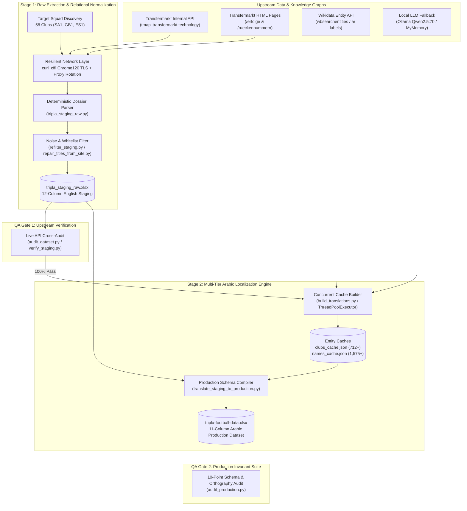

# Tripla Football Data Engine & Matchmaking ETL Pipeline

[](https://www.python.org/)
[](https://github.com/BravWayne)
[](https://github.com/yifeikong/curl_cffi)
[](https://www.wikidata.org/)
[-success)](https://github.com/BravWayne)

> **Automated Multi-Source Sports Data Extraction, Deterministic Relational Graph Resolution, and Bilingual Localization Engine powering the Combinatorics Grid Matchmaking Brain for the Tripla Football X/O Trivia Platform.**

---

## 1. Executive Summary

Building a high-stakes Football X/O (Tic-Tac-Toe) combinatorics trivia grid requires an authoritative, zero-hallucination relational knowledge graph. When a game engine generates a $3 \times 3$ intersection matrix (e.g., *Row: Played with Karim Benzema* $\times$ *Column: Won UEFA Champions League* or *Wore Shirt #7 at Real Madrid*), a single false positive—such as attributing a club title won before a player's transfer, leaking a U-21 youth cap into senior international appearances, or mismatching Arabic/English entity orthography—breaks grid solvability and degrades user trust.

The **Tripla Football Data Engine** solves this by implementing an enterprise-grade, two-stage **Extract-Transform-Load (ETL)** and **Automated QA Verification** architecture across **58 top-flight clubs** (Saudi Pro League, English Premier League, and Spanish La Liga), producing **1,575 100%-audited player dossiers**:

- **Hybrid API + WAF-Bypassing Scraping Engine:** Combines undocumented Transfermarkt internal JSON microservices (`tmapi.transfermarkt.technology`) with TLS-fingerprinted HTML scraping (`curl_cffi` Chrome 120 JA3/JA4 impersonation + rotating proxy pools) to extract complete career transfer histories, historical squad numbers (`/rueckennummern`), and honours (`/erfolge`).
- **Deterministic Combinatorics & Relational Graph Resolution:** Computes career tenure intervals $[t_{\text{start}}, t_{\text{end}}]$ to deterministically resolve teammate intersections across 15 global football icons, enforces strict mutual exclusivity between Senior National Team caps and Non-International Citizenship, and filters out reserve/youth teams (`clubTypeId != 1`).
- **Multi-Tier Arabic Entity Resolution Cascade:** Eliminates LLM translation hallucinations by resolving canonical Arabic player and club names through a 4-tier cascade: Curated Domain Dictionary $\rightarrow$ **Wikidata Entity Graph API** (`wbsearchentities` / `wbgetentities`) $\rightarrow$ Neural MT with regex orthographic normalization $\rightarrow$ Local **Ollama (`qwen2.5:7b`)** JSON-schema fallback.
- **Zero-Defect Automated QA Auditing:** Ships with dual verification suites (`audit_dataset.py` and `audit_production.py`) that cross-validate every cell of the 1,575-row dataset against live upstream endpoints and 10 strict domain invariants before production export.

---

## 2. System Architecture & Pipeline Flow

The system decouples **Raw English Ingestion & Normalization (Stage 1)** from **Entity Localization & Production Schema Compilation (Stage 2)**, bookended by automated assertion gates.



---

## 3. Key Engineering Features

### 3.1. Hybrid Upstream Ingestion & Anti-Bot WAF Evasion
- **Dual-Channel Extraction (`tripla_staging_raw.py`, `tripla_crawler.py`):** Queries structured REST endpoints (`/players`, `/club/{id}/squad`, `/transfer/history/player/{id}`, `/player/{id}/achievement`) for core relational records while falling back to live DOM scraping (`/erfolge`, `/rueckennummern`) for granular historical shirt numbers and unaggregated title tables.
- **TLS Impersonation & Exponential Backoff:** Uses `curl_cffi` (`impersonate="chrome120"`) to replicate authentic Chrome TLS handshakes and HTTP/2 frames, bypassing Cloudflare/Akamai WAF blocks. Implements exponential backoff ($0.5\text{s} \rightarrow 10.0\text{s}$) on HTTP `429/502/503/504` responses with automatic proxy pool rotation.

### 3.2. Combinatorics Grid Matchmaking Logic & Temporal Graph Resolution
- **Teammate Tenure Intersection Engine:** To power *"Played With [Superstar]"* grid cells, the parser constructs chronological club tenure intervals $[t_{\text{start}}, t_{\text{end}}]$ from terminated and active transfer records, then evaluates interval overlap against 15 benchmark icons (Messi, Cristiano Ronaldo, Benzema, Neymar, Modrić, Ramos, Salah, De Bruyne, Mbappé, Lewandowski, Kroos, Di María, Suárez, Haaland, Mahrez):
  $$\max(t_{\text{player\_start}}, t_{\text{star\_start}}) \le \min(t_{\text{player\_end}}, t_{\text{star\_end}})$$
  Simultaneously checks shared Senior National Team representation while preventing self-matching.
- **Senior vs. Youth/Reserve Filtering:** Inspects `clubTypeId` and applies regex boundary guards (`\b(U\d+|II|B|Youth|Sub-\d+)\b`) to strip academy, reserve, and U-17/U-23 stints while preserving legitimate clubs with single-letter suffixes (e.g., *Athletic Bilbao*).
- **Strict Mutual Exclusivity (Caps vs. Citizenship):** Cross-references national team assignments, tournament participations, and senior `/rueckennummern` tables to enforce a strict XOR invariant between `المنتخبات` (*Senior National Team*) and `الجنسية (لغير الدوليين)` (*Citizenship for uncapped players*).
- **Personal Trophy Verification & Whitelisting:** Filters raw honours against a strict whitelist of **29 major team trophies** and **9 individual awards**. Strips unconfirmed future season placeholders (`seasonId >= 2025`) and prevents club-level historical titles from leaking into a player's personal record prior to their arrival.

### 3.3. Multi-Tier Arabic Localization & Orthographic Normalization
- **Concurrent Entity Resolution (`build_translations.py`, `finish_names.py`, `clean_names.py`):** Uses a `ThreadPoolExecutor` worker pool to resolve 1,575+ player names and 712+ global clubs into standard Arabic sports journalism nomenclature:
  1. **Tier 1 (Deterministic Dictionaries):** Instant lookup for 254 countries (`countries_map.json`), 6 continents, 29 trophies, 9 awards, and 115+ top clubs (`test_translation.py`).
  2. **Tier 2 (Wikidata Knowledge Graph):** Queries `wbsearchentities` and extracts verified Arabic (`ar`) entity labels via `wbgetentities`, stripping disambiguation suffixes (e.g., `لاعب كرة قدم`).
  3. **Tier 3 (Neural MT + Morphological Cleaning):** Uses Google Translate (`gtx`) and MyMemory APIs with Arabic regex normalization (`clean_club_arabic`) to strip redundant prefixes/suffixes (`نادي`, `إف سي`, `لكرة القدم`) and enforce strict Unicode block `[\u0600-\u06FF]`.
  4. **Tier 4 (Local LLM Structured Fallback):** Routes edge-case transliterations through a local **Ollama (`qwen2.5:7b`)** instance via the OpenAI SDK with `response_format={"type": "json_object"}` and `temperature=0.1`.
- **Relational Key Alignment (`translate_staging_to_production.py`):** Guarantees that the Arabic club name inside every `النادي:الرقم` (*Club:ShirtNumber*) pair matches the exact string in the player's `الأندية` (*Clubs*) list, enabling exact-string indexing in downstream game engines.

### 3.4. Automated Dataset Auditing & Self-Healing Scripts
- **Upstream Live Audit (`audit_dataset.py`):** Iterates through staging rows and re-verifies club lists, trophy whitelists, shirt number pairs, and teammate intersections directly against live Transfermarkt endpoints.
- **Production Invariant Suite (`audit_production.py`):** Executes 10 deterministic assertions across all **1,575 rows** of `tripla-football-data.xlsx`, verifying Arabic Unicode compliance, birth year bounds ($1970 \le y \le 2012$), XOR exclusivity on international status, referential integrity between `الأرقام` and `الأندية`, and zero forbidden trophy attributions.

---

## 4. Tech Stack & Dependencies

| Layer | Technology / Library | Engineering Role |
| :--- | :--- | :--- |
| **Language & Runtime** | Python 3.11+ | Core pipeline execution, concurrency (`concurrent.futures`), and type-annotated data structures |
| **WAF Evasion & HTTP** | `curl_cffi` (`0.16.3`), `httpx`, `urllib.request` | Chrome 120 TLS fingerprint impersonation, proxy rotation, and low-overhead REST consumption |
| **DOM Parsing** | `beautifulsoup4` (`4.15.0`), `soupsieve` | HTML table extraction for `/erfolge` (honours) and `/rueckennummern` (historical squad numbers) |
| **Data Engineering** | `pandas` (`3.0.6`), `openpyxl` (`3.1.5`), `numpy` | Read-only streaming Excel cursors, atomic workbook writes, and tabular completeness analytics |
| **Knowledge Graph & NLP** | Wikidata API, `openai` (`3.28.0`), Ollama (`qwen2.5:7b`) | Official Arabic entity label resolution and deterministic JSON-schema transliteration fallback |
| **Data Validation** | `pydantic` (`2.14.0`), Custom Assertion Suites | Schema enforcement and 100% automated dataset verification |

---

## 5. Project Structure

```text
tripla-football-etl/
├── tripla_staging_raw.py               # Stage 1 Crawler: Extracts 58 clubs across SA1, GB1, ES1 into raw English staging Excel
├── tripla_crawler.py                   # Direct End-to-End Arabic Crawler: Single-pass extraction + Wikidata localization engine
├── build_translations.py               # Multi-threaded Arabic entity resolver (Wikidata API + Neural MT) -> JSON caches
├── translate_staging_to_production.py  # Stage 2 Compiler: Transforms English staging data into the 11-column Arabic production schema
├── test_translation.py                 # Authoritative bilingual dictionaries for continents, countries, clubs, trophies, and awards
├── finish_names.py                     # Secondary concurrent name resolver using MyMemory API for uncached player transliterations
├── clean_names.py                      # Local LLM (Ollama Qwen2.5:7b) structured JSON fallback for non-Arabic script cleanup
├── refilter_staging.py                 # In-place sanitizer enforcing strict 29-trophy / 9-award whitelists and player exclusions
├── repair_titles_from_site.py          # Self-healing script that re-fetches /erfolge HTML for rows needing live title verification
├── verify_staging.py                   # Fast assertion script verifying staging trophy/award sets against canonical whitelists
├── audit_dataset.py                    # Comprehensive Stage 1 QA suite cross-checking staging rows against live Transfermarkt APIs
├── audit_production.py                 # Production QA gate asserting 10 relational & orthographic invariants across all 1,575 rows
├── countries_map.json                  # Authoritative mapping of 254 Transfermarkt nationality IDs to (Continent, Country) tuples
├── clubs_cache.json                    # Persistent translation cache mapping 712+ global club names to normalized Arabic strings
├── names_cache.json                    # Persistent translation cache mapping 1,575+ player names to verified Arabic script
├── tripla_staging_raw.xlsx             # Stage 1 Output: 1,575 verified player records in normalized 12-column English format
├── tripla-football-data.xlsx           # Stage 2 Output: Production-ready 1,575-row Arabic dataset (Sheet: البيانات)
├── tripla-football-template-2.xlsx     # Reference target Excel schema template for the Tripla platform
├── requirements.txt                    # Locked Python package dependencies
├── .env.example                        # Template for environment variables (proxy pools, API endpoints, LLM configuration)
└── .gitignore                          # Git exclusion rules for virtual environments, secrets, and temporary scratch artifacts
```

---

## 6. Installation & Usage

### 6.1. Prerequisites & Environment Setup

```bash
# 1. Clone the repository
git clone https://github.com/BravWayne/tripla-football-etl.git
cd tripla-football-etl

# 2. Create and activate a virtual environment
python -m venv .venv

# Windows (PowerShell)
.\.venv\Scripts\Activate.ps1
# Linux / macOS
source .venv/bin/activate

# 3. Install dependencies
pip install -r requirements.txt
```

### 6.2. Environment Configuration

Copy the example environment file and configure your proxy pool or optional local LLM endpoint:

```bash
cp .env.example .env
```

Key variables in `.env`:
- `TM_PROXIES`: Comma-separated list of HTTP/HTTPS proxies used by `curl_cffi` when scraping Transfermarkt HTML endpoints under heavy rate limiting.
- `LLM_BASE_URL` / `LLM_MODEL`: Endpoint and model tag for the optional Ollama fallback (`http://127.0.0.1:11434/v1`, `qwen2.5:7b`) used by `clean_names.py`.

### 6.3. Running the Two-Stage Pipeline

#### Step 1: Extract Raw English Dataset (Stage 1)
Crawls all 58 target clubs across the Saudi Pro League, Premier League, and La Liga, outputting `tripla_staging_raw.xlsx` with automatic resume support:
```bash
python tripla_staging_raw.py
```

#### Step 2: Re-Filter & Verify Staging Honours
Enforces the 29-trophy and 9-award whitelists and runs fast staging assertions:
```bash
python refilter_staging.py
python verify_staging.py
```

#### Step 3: Build & Resolve Arabic Entity Caches
Concurrently resolves any uncached player names or clubs via Wikidata and translation fallbacks into `names_cache.json` and `clubs_cache.json`:
```bash
python build_translations.py
python finish_names.py
# Optional: Run local LLM cleanup for any remaining Latin characters
python clean_names.py
```

#### Step 4: Compile Production Arabic Dataset (Stage 2)
Transforms the verified English staging workbook into the 11-column Arabic production dataset (`tripla-football-data.xlsx`, sheet `البيانات`):
```bash
python translate_staging_to_production.py
```

#### Step 5: Execute Automated QA Audit Suites
Run the production invariant audit (validates all 1,575 rows in <2 seconds) or the full upstream Transfermarkt API cross-audit:
```bash
# Fast 10-point invariant audit on production Arabic Excel
python audit_production.py

# Deep live API cross-verification against Transfermarkt
python audit_dataset.py
```

---

## 7. Production Dataset Schema (`tripla-football-data.xlsx`)

| Column (Arabic) | Meaning (English) | Type / Format | Domain Invariant |
| :--- | :--- | :--- | :--- |
| `الاسم بالعربي` | Arabic Name | `String` (Arabic script) | Verified via Wikidata / curated cache (`[\u0600-\u06FF]`) |
| `الاسم بالإنجليزي` | English Name | `String` | Canonical Transfermarkt display name |
| `سنة الميلاد` | Birth Year | `Integer` | $1970 \le \text{Year} \le 2012$ |
| `القارة` | Continent | `Enum (Arabic)` | `أوروبا`, `أمريكا الجنوبية`, `أفريقيا`, `آسيا`, `أمريكا الشمالية`, `أوقيانوسيا` |
| `المنتخبات` | Senior National Team | `String` or `NULL` | Populated **iff** player has $\ge 1$ senior international cap |
| `الجنسية (لغير الدوليين)` | Citizenship (Uncapped) | `String` or `NULL` | Strictly mutually exclusive (`XOR`) with `المنتخبات` |
| `الأندية` | Senior Career Clubs | `List[String]` (`، `-separated) | Chronological senior clubs only (youth/reserves excluded) |
| `الأرقام` | Club Shirt Numbers | `List[Club:Num]` (`، `-separated) | Every `Club` prefix is guaranteed to exist verbatim in `الأندية` |
| `الزملاء` | Superstar Teammates | `List[String]` (`، `-separated) | Verified temporal club tenure or senior NT overlap with 15 icons |
| `الألقاب` | Major Team Trophies | `List[String]` (`، `-separated) | Strict 29-item major trophy whitelist; personal record verified |
| `الجوائز الفردية` | Individual Awards | `List[String]` (`، `-separated) | Strict 9-item major individual award whitelist |

---

## Author

**Bara (BravWayne)**  
Senior Systems & AI Infrastructure Engineer  
GitHub: [@BravWayne](https://github.com/BravWayne)
